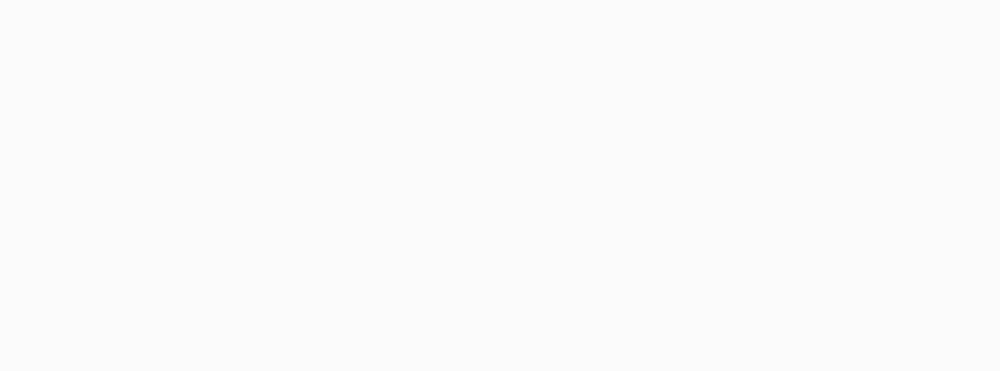

# 👋 嗨，你找到了一个非常雷霆抽象的人并进入了她的雷霆大主页！！

### ✨ 欢迎来到我的 GitHub 小宇宙 ✨

🎨 正在学习新东西 · ☕ 靠"""["碳","氢","氧","氮","磷"]"""续命 · 🐛 偶尔和 Bug 聊聊天（你这代码怎么这样？！）

---

##  关于我
<!-- ### 我来自哪里？
嘿！我才不会直接说我来自哪里！那是一种愚蠢的行为！😆
> 我的高中：
_中山市烟洲中学_
---

---
> 我学习美术的地方：
_江山艺术_
---

---
### 其他
- 🔭 最近在折腾：**[如何让自己变得更聪明🤔]**
- 🌱 正在学习：**[Python , HTML , 美术以及高中课程]**
- 🎯 接下来想做：**[冲刺！2027年全国性美术联合考试（美术联考）]**
- 💬 可以和我聊：**[美术创作，或是如何用代码实现一些很好玩的东西]**
---
-->
### ⚡ 关于我的冷知识：
**（1）我的前额叶一直处于一种浆糊一样的状态，所以我总是傻乎乎的**

**（2）做某些事情就是"while True"停不下来（比如沉浸式写代码、手绘，还有调用web服务——说人话就是上网冲浪）**

**容易应激然后炸毛**
---

## 🧰 我的工具箱（实际上并不能熟练使用）

## 🚀 最近在这里做的事情

| 项目 | 介绍 | 当前状态 |
|---|---|---|
| [animals](https://github.com/ln1325/animals) | 一个让我很开心的小作品，这很“艺术人”！ | 🛠️ 正在开发 |
| [sketch-single-person-templates](https://github.com/ln1325/sketch-single-person-templates) | 美术联考素材库 - 速写素材_单人模板 | 已经完成全部文件上传，要看看吗？ |

## 🎲 今日份小目标

- [ ] 写一点代码，或是学点新东西
- [ ] 每日欣赏<a href=https://github.com/explore>GitHub Explore</a>日推
- [ ] 四周游荡，就像野猫走来走去一样，然后发呆<ins>打瞌睡（冬季特供）</ins>
- [ ] 打开电脑然后莫名其妙在test文件夹run一遍pytest
- [ ] 每日一清Temp文件夹

## 📊 GitHub 小数据（没什么好看的，我只是个无名之辈）

## 🐾 我是爱猫人士，如果有我认为很可爱的小猫咪我会为它画一幅水彩或素描
_我的头像就是我为一只三花猫画的水彩，它的名字叫“茉莉”(jasmine)，它的主人是我的同学，她的绘画技术比我更高超！_

> 如果你愿意分享你的猫咪照片，我会考虑给它画一张水彩或素描（如果你有猫或者是有喜欢的猫），我会将这些可爱的猫猫放在我的某一个仓库的issue，在这个issue里发送你的猫咪照片，我看到后会考虑是否动手创作（=^·◞◟·^=）~
---

### 感谢来访！祝你今天也有好心情!Happy coding! 🌈

