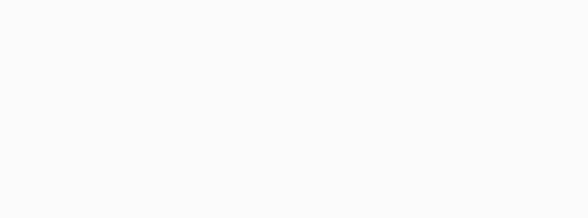
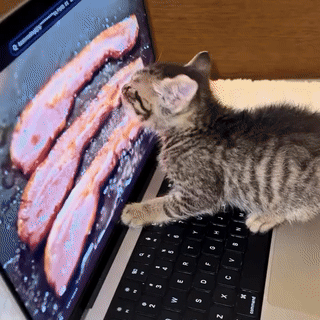
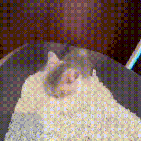

<h1>北京时间 2026年11月28日00时至11月30日24时 我将进行美术联考，届时我将暂停更新仓库</h1>
 
<h3>👋 嗨，你找到了一个非常雷霆抽象的人并进入了她的雷霆大主页！！</h3>

### ---- ✨ 欢迎来到我的 GitHub 小宇宙 ✨ ----

- 🎨 正在学习新东西和旧东西
- ☕ 靠最基本的化学物质
‘’’
["碳","氢","氧","氮","磷","钠","氯"]
‘’’
续命
- 🐛 偶尔和 Bug 聊聊天（你这代码怎么这样？！）
- 孤单的时候会想BinarySearch(“cat”)//找猫…这比对着橡皮鸭发呆好太多了

---

---

##  关于我
### 我来自哪里？
嘿！我才不会直接说我来自哪里！那是一种愚蠢的行为！😆
> 我的高中：
_中山市烟洲中学_
---

---
> 我学习美术的地方：
_江山艺术_
---
)
---
### 其他
- 🔭 最近在折腾：**如何让自己变得更聪明🤔**
- 🌱 正在学习：**Python , HTML , 美术以及高中课程**
- 🎯 接下来想做：**冲刺！2027年全国性美术联合考试（美术联考）**
- 💬 可以和我聊：**美术创作，或是如何用代码实现一些很好玩的东西**
- 📑 可以让我做：**优化中文文档（如果你的额度用完了又很着急要优化一门不熟悉的语言写成的readme）**
---
### ⚡ 关于我的冷知识：
**（1）我的前额叶一直处于一种浆糊一样的状态，所以我总是傻乎乎的**

**（2）做某些事情就是"while True"停不下来（比如沉浸式写代码、手绘，还有调用web服务——说人话就是上网冲浪）**

**（3）容易应激然后生气炸毛，同时也很胆小容易被吓哭，因为杏仁核极其发达……**

**（4）每周末脑子随机重置到任意挡位（低能 - 正常 - 平衡变化 - 聪明 - 超级无敌聪明）**

**（5）在我发现某种食物美味且实惠时，我就会把吃这个食物丢进while True，直到我发现比它更优的选择我才会停止🤤**

---

---

## 🧰 我的工具箱（实际上并不能熟练使用并且大部分时候是“积满灰尘”的状态）

## 🚀 最近在这里做的事情

> 注意⚠️：我将于北京时间2026年12月01日00时不再向素材库上传图片，但仍接受PR（图片素材添加/文档优化）和issues（素材分享/版权问题反馈），所有与美术联考相关的素材库暂定于北京时间2030年1月1日11时至13时删除，以腾出更多空间给想要发挥创意的人，毕竟这里是开源社区，我的素材库不算是好东西，况且我并不自私

| 项目 | 介绍 | 当前状态 |
|---|---|---|
| [animals](https://github.com/ln1325/animals) | 一个让我很开心的小作品，这很“艺术人”！ | 🛠️ 正在开发 |
| [sketch-full-scene](https://github.com/ln1325/sketch-full-scene) | 美术联考素材库 - 速写素材_场景模版 | 最完整的速写考试答卷画面参考，要看看吗？ |
| [readable-code-skill](https://github.com/ln1325/readable-code-skill) | 闲的没事干跟AI一起做了一个skill | 已经不知道怎么写下去了，用完记得给我”锐评”👊😆 |

## 🎲 今日份小目标

- [ ] 写一点代码，或是学点新东西
- [ ] 每日欣赏<a href=https://github.com/explore>GitHub Explore</a>日推
- [ ] 浇花，赏花，玩弄水草和金鱼（这通常占据我假期生活的大部分）
- [ ] 四周游荡，就像野猫走来走去一样，然后发呆<ins>打瞌睡（冬季特供）</ins>
- [ ] 打开电脑然后莫名其妙在test文件夹run一遍pytest
- [ ] 每日一清Temp文件夹

**👾你快去写代码！不要发呆啦！👾**

—-

## 📊 GitHub 小数据（没什么好看的，我只是个无名之辈）

## 🐾 我是爱猫人士，如果有我认为很可爱的小猫咪我会为它画一幅水彩或素描
_我的头像就是我为一只三花猫画的水彩，它的名字叫“茉莉”(jasmine)，它的主人是我的同学，她的绘画技术比我更高超！_

> 如果你愿意分享你的猫咪照片，我会考虑给它画一张水彩或素描（如果你有猫或者是有喜欢的猫），我会将这些可爱的猫猫放在我的某一个仓库的issue，在这个issue里发送你的猫咪照片，我看到后会考虑是否动手创作（=^·◞◟·^=）~
---

### 感谢来访！祝你今天也有好心情!Happy coding! 🌈

